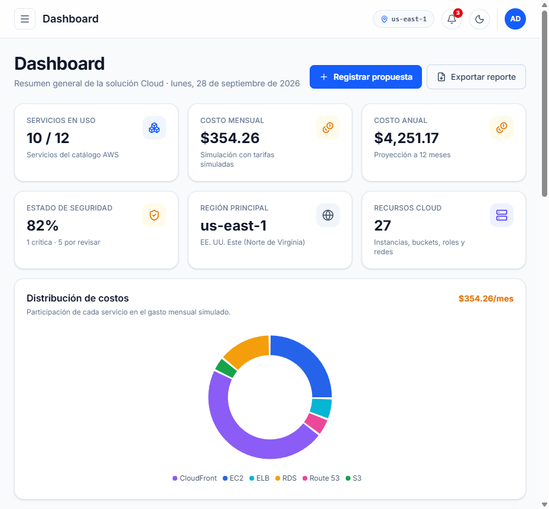
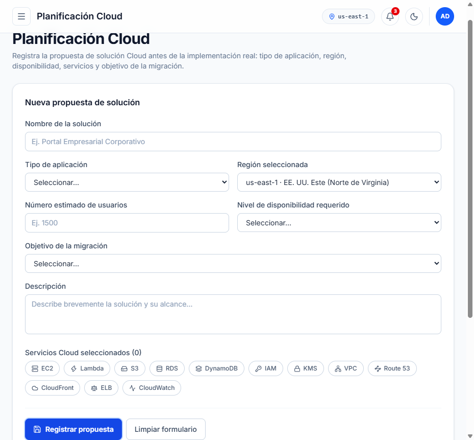
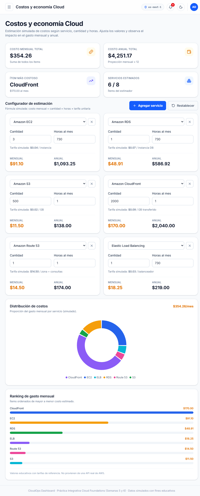
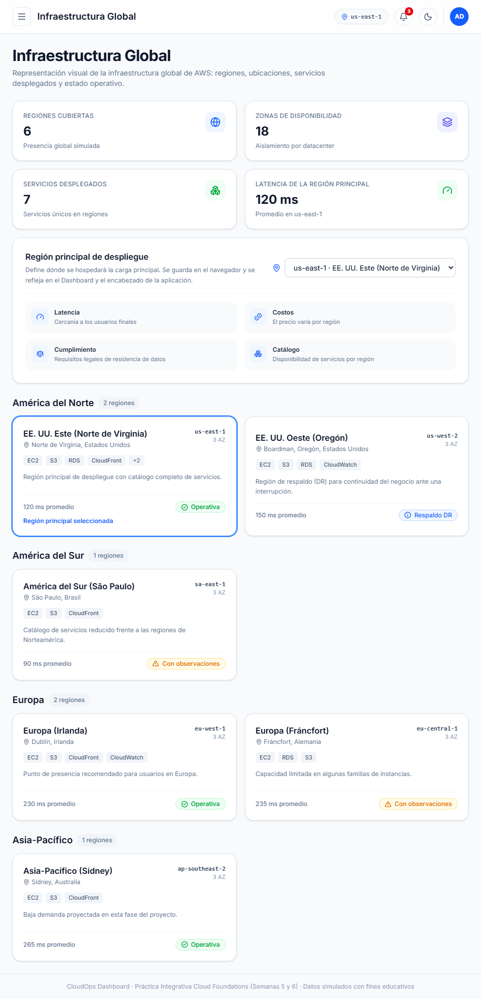
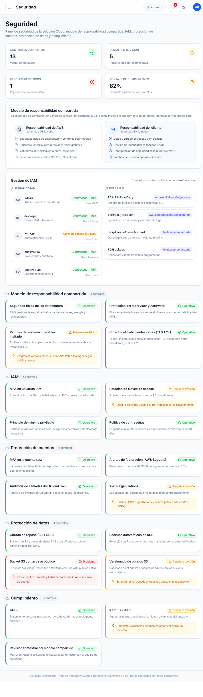
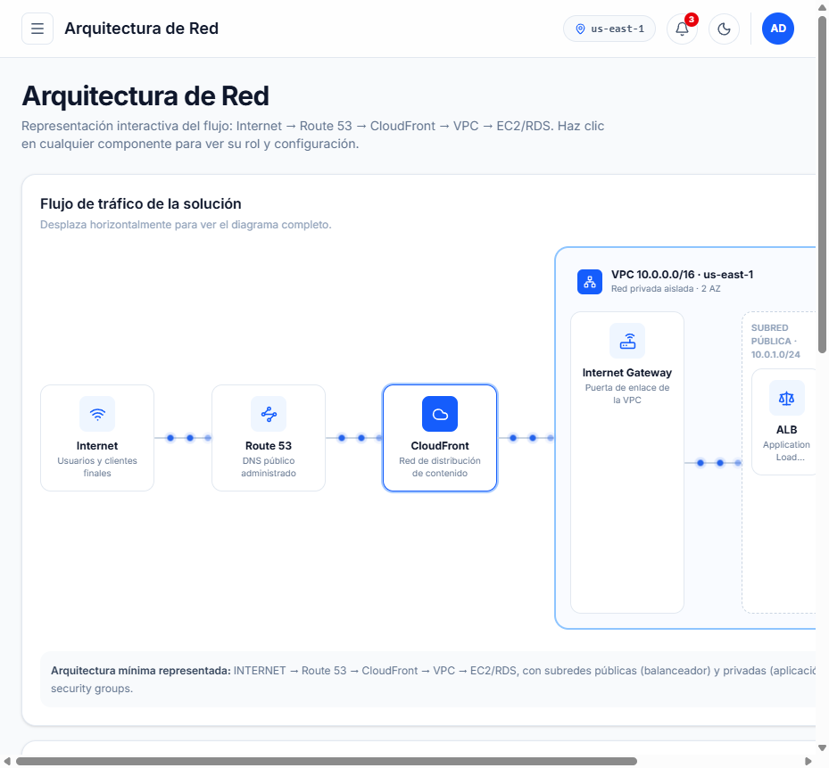
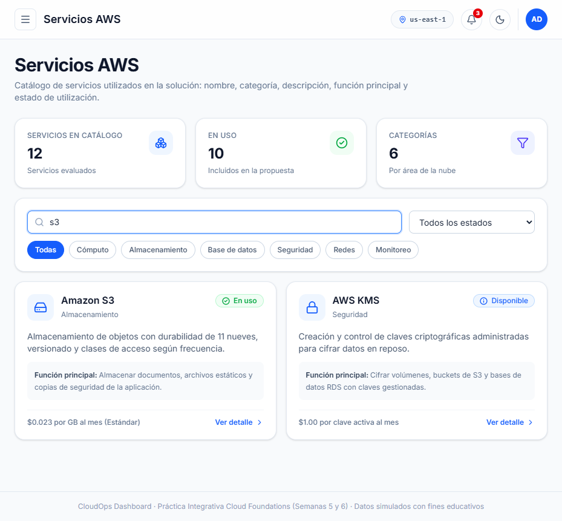
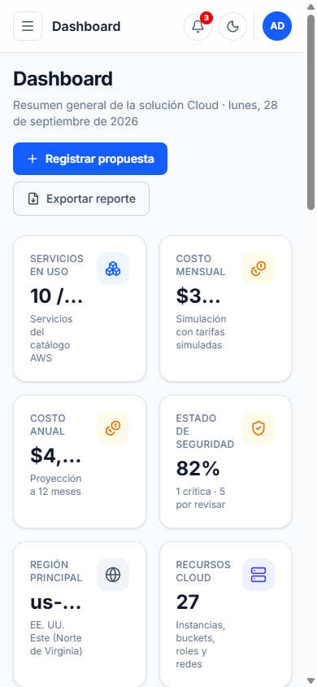
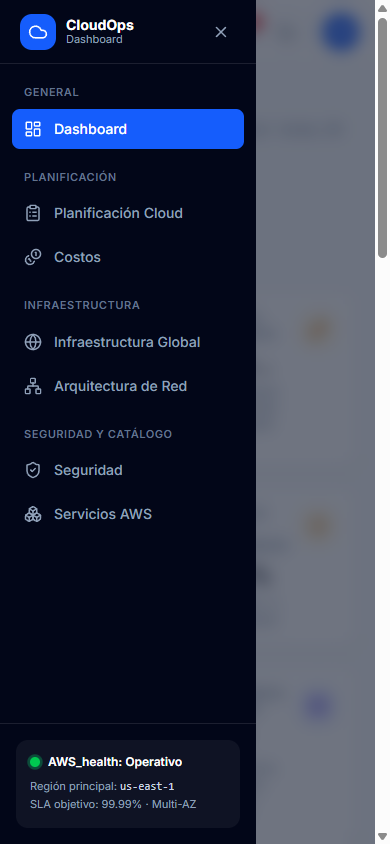
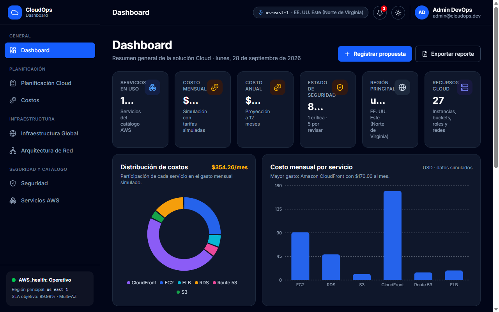

# CloudOps Dashboard

**Sistema web para la planificación y visualización de una solución Cloud basada en AWS**

> Práctica Integrativa — Cloud Foundations (Semanas 5 y 6) · React + TypeScript

## Descripción

CloudOps Dashboard es un panel profesional que permite **planificar, visualizar y analizar** los componentes fundamentales de una solución de computación en la nube **antes** de realizar una implementación real en AWS: infraestructura global, estimación de costos, seguridad, administración de identidades (IAM) y arquitectura de red.

La aplicación utiliza **datos simulados** (mock) con fines educativos. No se conecta a ninguna API real de AWS.

## Tecnologías

| Tecnología | Uso |
| --- | --- |
| React 19 + TypeScript | Framework de la interfaz y tipado estático |
| Vite 8 | Servidor de desarrollo y build |
| Tailwind CSS 4 | Diseño, tema claro/oscuro y responsive |
| React Router 6 | Navegación entre módulos |
| Lucide React | Iconografía |
| Recharts 3 | Gráficos de costos |

## Instalación y ejecución

```bash
# 1. Instalar dependencias
npm install

# 2. Servidor de desarrollo (http://localhost:5173)
npm run dev

# 3. Compilación de producción (verifica tipos y genera /dist)
npm run build

# 4. Previsualizar el build de producción
npm run preview
```

## Módulos

| Ruta | Módulo | Contenido |
| --- | --- | --- |
| `/dashboard` | Dashboard | 6 indicadores (servicios, costos mensual/anual, seguridad, región, recursos), gráfico de distribución de costos (donut), gráfico de barras, resumen de seguridad y propuesta activa. Exportación del reporte mediante impresión. |
| `/planning` | Planificación Cloud | Formulario para registrar la propuesta (nombre, tipo de app, descripción, región, usuarios, disponibilidad, servicios y objetivo) con validación. Visualiza las propuestas en tarjetas y las persiste en `localStorage`. |
| `/costs` | Costos y economía Cloud | Estimador interactivo: selección del servicio, cantidad y horas; costo estimado mensual/anual por ítem y totales. Gráfico de distribución + ranking de gasto. Persistencia en `localStorage`. |
| `/infrastructure` | Infraestructura Global | 6 regiones agrupadas por continente con ubicación, AZ, latencia, servicios desplegados y estado. Selector de región principal persistente que se refleja en toda la app. |
| `/security` | Seguridad | Modelo de responsabilidad compartida (AWS vs. cliente), panel IAM (usuarios, roles, MFA, políticas) y 19 controles con indicadores verde/amarillo/rojo por categoría. |
| `/network` | Arquitectura de Red | Diagrama interactivo INTERNET → Route 53 → CloudFront → VPC → EC2/RDS con animación de flujo de tráfico, subredes públicas/privadas y panel de detalle por componente (protocolos y buenas prácticas). |
| `/services` | Servicios AWS | Catálogo de 12 servicios (EC2, S3, RDS, IAM, VPC, Route 53, CloudFront y más) con nombre, categoría, descripción, función principal y estado de uso. Buscador, filtros por categoría/estado y vista detallada en modal. |

## Componentes reutilizables

`Layout`, `Sidebar`, `Header`, `PageHeader`, `StatCard`, `ServiceCard`, `CostCard`, `SecurityCard`, `RegionCard`, `StatusBadge`, `CostPieChart`, `CostBarChart`

## Estructura del proyecto

```
src/
├── components/        # Componentes reutilizables (+ charts/)
├── pages/             # 7 módulos de la aplicación
├── data/              # Datos simulados: awsServices, regions, costs, security, network
├── types/             # Tipos TypeScript (cloud.ts)
├── lib/               # utilidades: storage (localStorage), cálculo de costos, formatos
├── context/           # AppContext: tema y región seleccionada
├── App.tsx            # Definición de rutas
└── main.tsx           # Punto de entrada
```

## Requisitos funcionales cubiertos

- Dashboard con indicadores, gráficos y resumen de seguridad
- Navegación funcional entre los 7 módulos
- Registro de propuestas Cloud con validación de campos
- Selección de servicios en la propuesta
- Visualización de regiones con estado y servicios
- Calculadora de costos simulada (servicio, cantidad, horas)
- Gráficos de distribución de costos
- Consulta de seguridad (responsabilidad compartida, IAM, cuentas, datos, cumplimiento)
- Arquitectura de red interactiva representada en la interfaz (no es una imagen)
- Catálogo de servicios con estados
- Indicadores semafóricos (verde / amarillo / rojo)
- Diseño responsive: sidebar colapsable en móvil y rejillas adaptativas

## Retos adicionales implementados

- Modo oscuro con persistencia
- Buscador de servicios y filtros por categoría
- Vista detallada de cada servicio (modal)
- Selector de regiones persistente (se refleja en Dashboard y Header)
- Notificaciones en el encabezado
- Exportación del reporte del Dashboard (window.print con estilos de impresión)
- Animaciones y transiciones (flujo de tráfico, entrada de páginas, modales)
- Persistencia mediante localStorage (propuestas y costos)

## Capturas de evidencia

| Captura | Contenido |
| --- | --- |
|  | Dashboard con indicadores y gráficos |
|  | Propuesta registrada con persistencia |
|  | Estimador y gráfico de distribución |
|  | Regiones agrupadas por continente |
|  | Responsabilidad compartida, IAM y controles |
|  | Arquitectura interactiva con flujo animado |
|  | Catálogo con buscador activo |
|  | Vista móvil 390px |
|  | Sidebar colapsable con hamburger |
|  | Tema oscuro global |

## Diseño

Paleta aplicada según la guía de la práctica: fondo `#F8FAFC`, sidebar `#0F172A`, color principal `#2563EB`, seguridad `#16A34A`, costos `#F59E0B`, alertas `#DC2626`, texto principal `#1E293B`, texto secundario `#64748B`, bordes `#E2E8F0` y cards `#FFFFFF`, con `border-radius` de 12–16px y sombra ligera. Tipografía Inter con jerarquía de 28–32px (títulos), 14–16px (texto) y 12–14px (secundario).

## Notas

- Los costos, latencias y estados son **valores simulados** para fines académicos.
- Para reiniciar los datos guardados (propuestas, costos, tema y región), limpia el `localStorage` del navegador.
